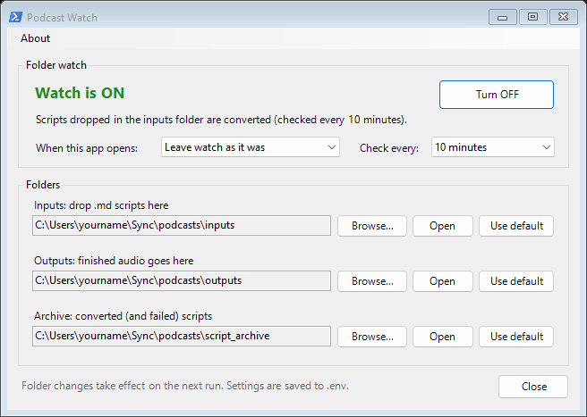

# podcast_generator — User Manual

A companion to [README.md](README.md) — that file gets you running in five
minutes; this one covers everything else: how to write a script, the full
CLI reference, the voice catalog, the Podcast Watch desktop app, using it
from Claude Desktop (MCP), and troubleshooting.

## What this does

`generator.py` takes a markdown file — a podcast script — and turns it
into an audio file (MP3 or WAV) using [Kokoro](https://github.com/hexgrad/kokoro),
a free, open-source text-to-speech model that runs entirely on your own
machine via [`voxport`](https://github.com/brienalkire/voxport). No API key, no per-use cost, and
(once the model is cached) no internet connection required.

## Writing a script

Any markdown file works, but a few conventions control exactly what gets
spoken aloud versus stripped out before synthesis:

- **Headers** (`#`, `##`, `###`, ...) are removed entirely — including
  their text. If you use headers as section labels (`## OPENING`,
  `## CLOSING`), those labels are *not* spoken.
- **Metadata lines** matching `**Key:** value` (e.g. `**Author:** ...`,
  `**Date:** ...`) are removed. This is also how `**Voice:** af_heart`
  works — see below.
- **Horizontal rules** (`---`, `***`, `___`) are removed.
- **An entirely-italic line** (e.g. `*Source: ...*` or `*End of script.*`)
  is a production note. Before any spoken prose it's skipped as front
  matter. After prose has started it's the end-of-script marker, and
  **everything from that line to the end of the file is dropped, not just
  that line.** This is meant for a trailing citation or production note,
  but it's a common gotcha: if a normal sentence in the middle of your
  script happens to be wrapped entirely in `*asterisks*`, everything after
  it will silently go unspoken. Keep italic-only lines for the very top or
  very end of the file only.
- **Inline formatting** — `**bold**`, `*italic*`, `` `code` ``,
  `[link text](url)` — has its markup stripped but the text itself is
  kept and spoken normally.
- Blank lines are preserved as paragraph breaks; runs of 3+ blank lines
  collapse to one.

Everything else — plain paragraphs — is spoken as-is. A minimal script:

```markdown
# My Episode Title

**Voice:** af_heart

## OPENING

Welcome back to the show. Today we're talking about...

## CLOSING

That's all for this episode. Thanks for listening.

---

*Source: some-article.com, September 2026.*
```

Only "Welcome back to the show..." and "That's all for this episode..."
get spoken — the title, section labels, voice metadata, and trailing
source note are all stripped.

### Choosing a voice

Precedence, highest to lowest:

1. `--voice` on the command line — applies to every script in that run.
2. A `**Voice:**` line in the script's own header.
3. The built-in default (`af_heart`).

This lets you set a default for most episodes while overriding specific
ones — e.g. a recurring segment that always uses a different voice.

## Full CLI reference

```
python generator.py [input_script.md] [options]
```

| Argument | Meaning |
|---|---|
| `input_script.md` (positional, optional) | Convert just this one file instead of batch-processing the inputs folder. |
| `--voice VOICE` | Kokoro voice for the whole run (see catalog below). Overrides any `**Voice:**` line. |
| `--lang CODE` | Accent code (`a` American, `b` British). Defaults to the chosen voice's first letter — you'd only override this for an edge case. |
| `--speed FLOAT` | Speaking rate multiplier (default `1.0`; `0.9` slower, `1.1` faster). |
| `--format {mp3,wav}` | Output format (default `mp3`). |
| `--output PATH` | Output file path. Only used in single-file mode; ignored in batch mode. |
| `--version` | Print the installed version and exit. |

**Batch mode** (no positional argument): every `.md` file in the inputs
folder is converted, written to the outputs folder as
`<script-name>.<format>`, and (on success) moved to the archive folder.

**Single-file mode**: pass a path directly. `--output` only applies here.
Archiving still happens if the file you named happens to live in the
inputs folder; a file from anywhere else is left where it is.

## Voice catalog

Kokoro's voice names encode accent and gender in the first two letters
(`a`=American/`b`=British, `m`=male/`f`=female). These are the voices this
tool validates against and shows in `--help`:

| American male | American female | British male | British female |
|---|---|---|---|
| `am_onyx` | `af_heart` | `bm_george` | `bf_emma` |
| `am_adam` | `af_bella` | `bm_lewis` | `bf_isabella` |
| `am_echo` | `af_nova` | `bm_daniel` | `bf_alice` |
| `am_eric` | `af_sarah` | `bm_fable` | `bf_lily` |
| `am_fenrir` | `af_sky` | | |
| `am_liam` | `af_nicole` | | |
| `am_michael` | `af_aoede` | | |
| `am_puck` | `af_kore` | | |

We don't have authoritative per-voice character descriptions beyond the
defaults chosen for this project (`af_heart` for most episodes, `am_echo`
for one recurring series) — try a few on a short script and pick what
sounds right for your content. Kokoro supports more voices than this list
(including other languages); this tool's `--voice` choices are
deliberately limited to a curated English subset. If you need one outside
this list, it'll need adding to `VOICE_CHOICES` in `generator.py`.

**Only voices already in the local Hugging Face cache (see voxport's
README) work on a
machine with `HF_HUB_OFFLINE=1` set.** On a machine with normal internet
access, an uncached voice just downloads on first use — see voxport's
README for the full offline/online story.

## Scheduled ("drop folder") mode

Running `python generator.py` on a schedule turns the inputs folder into a
drop folder. Each run converts whatever scripts have arrived since the last
one and archives them, so nothing is processed twice. Point the folders at
a cloud-synced location and you can drop a script in from any device and
get the finished audio back out, with no manual run.

The schedule is a Windows scheduled task named `PodcastGeneratorWatch`
that runs every few minutes. Create it once with the **Set up watch**
button in the Podcast Watch app below (or by hand; see the README's
[Scheduled / "drop folder" mode](README.md#scheduled--drop-folder-mode)
section), then use the same app to control it.

Only one conversion runs at a time on a machine. If a run starts while
another is still converting, for example a scheduled check during a long
script, it leaves the queue to the run already going and exits.

## The Podcast Watch app

A small window for day-to-day control of the drop folder. Open it from the
**Podcast Watch** shortcut on your desktop. It runs
`scripts/podcast-watch.ps1` and needs nothing installed beyond Windows
PowerShell. Instructions for creating the shortcut are in the README.



The **About** menu at the top shows the version number and the author.

### Folder watch

- **Watch is ON / OFF** shows whether the scheduled task is enabled. When
  it's on, the line underneath gives the check interval.
- **Turn ON / Turn OFF** enables or disables the task. Turning it off only
  stops the schedule. Scripts already in the inputs folder stay there and
  are converted when you turn it back on. Manual `python generator.py` runs
  work either way.
- **When this app opens** decides what happens to the watch each time you
  open the window:
  - *Leave watch as it was* (the default) changes nothing.
  - *Turn watch ON* always switches it on, so opening the app is enough to
    start the watch.
  - *Turn watch OFF* always switches it off.

  The choice is saved immediately to `.env` as `PODCAST_WATCH_ON_OPEN`.
- **Check every** sets how often the watch looks for new scripts (5 to 60
  minutes). The change applies to the scheduled task straight away and
  doesn't turn the watch on or off.

#### Setting up the watch

On a machine where the watch has never been set up, the window says
**Watch not set up** and the button reads **Set up watch**. Pick an
interval under **Check every**, then click the button. The app registers
the `PodcastGeneratorWatch` scheduled task and turns it on. The task:

- runs under your own Windows account, with no admin rights or stored
  password, and only while you're logged in;
- runs on battery power as well as when plugged in;
- runs `.venv\Scripts\pythonw.exe generator.py`, so no console window
  flashes up on each check. Each run's output is appended to
  `generator.log` in the repo folder.

The app expects the repo's Python environment in `.venv` (see the README's
Installation section) and says so if it can't find it.

To remove the task, run
`Unregister-ScheduledTask -TaskName PodcastGeneratorWatch` in PowerShell
or delete it in Task Scheduler. The app then offers **Set up watch** again.

### Folders

The three folders `generator.py` uses, whether it runs on the schedule or
by hand:

| Folder | What goes there |
|---|---|
| **Inputs** | Scripts (`.md` files) waiting to be converted. |
| **Outputs** | Finished audio, named after the script (`my-episode.mp3`). |
| **Archive** | Scripts after conversion. Scripts that failed go to `failed/` inside it, each with a `.error.txt` note. |

For each folder:

- **Browse...** picks a different folder and saves it to `.env`.
- **Open** opens the folder in File Explorer, creating it first if it
  doesn't exist yet.
- **Use default** removes your choice from `.env`, so the folder goes back
  to the one inside this repo (`inputs/`, `outputs/`, or
  `script_archive/`). The label then reads "(default: in this repo)" and
  the button is greyed out.

Changes take effect on the next run. There's nothing to restart.

### Where settings are stored

Everything the app saves goes into `.env` in the repo folder, the same
file `generator.py` reads:

```
PODCAST_INPUTS_DIR=C:\Users\yourname\Sync\podcasts\inputs
PODCAST_OUTPUTS_DIR=C:\Users\yourname\Sync\podcasts\outputs
PODCAST_ARCHIVE_DIR=C:\Users\yourname\Sync\podcasts\script_archive
PODCAST_WATCH_ON_OPEN=on
```

The app changes only these lines and leaves the rest of the file,
including comments, as it was. You can still edit `.env` by hand;
`.env.example` documents every setting. `.env` is not committed to git,
so each machine keeps its own folders.

## Using it from Claude Desktop (MCP)

`mcp_server.py` lets an AI app that supports the
[Model Context Protocol](https://modelcontextprotocol.io), such as Claude
Desktop, make podcasts for you. You can ask, for example, "write a
10-minute episode explaining how tides work, read by a British voice", and
the app writes the script, queues it, converts it, and tells you where the
MP3 is. Everything still runs on your machine, using the same folders and
`.env` as the command line and the Podcast Watch app.

### Setting it up

1. Install the MCP package into the repo's environment (it's in
   `requirements.txt`, so a normal install already includes it):
   `pip install -r requirements.txt`.
2. In Claude Desktop, open Settings → Developer → Edit Config. Add this to
   `claude_desktop_config.json`, with your own repo path:

   ```json
   {
     "mcpServers": {
       "podcast-generator": {
         "command": "C:\\path\\to\\podcast_generator\\.venv\\Scripts\\python.exe",
         "args": ["C:\\path\\to\\podcast_generator\\mcp_server.py"]
       }
     }
   }
   ```

   If the file already has an `mcpServers` section, add the
   `"podcast-generator"` entry inside it.
3. Restart Claude Desktop. The tools appear under the tools (hammer or
   plug) menu in the chat box.

Other MCP clients that can start a local (stdio) server use the same
command and arguments.

### Tools

| Tool | What it does |
|---|---|
| `list_voices` | Lists the voices a script can use. |
| `queue_podcast` | Saves a script to the inputs folder under a name you choose, optionally setting its voice. It checks the script first: an unknown voice, a script with nothing to speak, or a name that's already taken is reported straight away, not after a failed conversion. Returns the word count and an estimated length. |
| `generate_now` | Starts converting everything queued, in the background, and returns at once. Does nothing if a conversion is already running. |
| `podcast_status` | Reports whether a podcast is queued, converting, done (with the file path, size, and length), or failed (with the reason). |
| `list_podcasts` | Shows the folders, whether the watch is on, what's queued, and recent audio and failures. |
| `set_watch` | Turns the scheduled watch on or off. |

Conversion never happens inside a tool call, because a long script takes
minutes. If the watch is on, a queued script is picked up on the next
check. Otherwise the AI calls `generate_now`. Either way, it checks back
with `podcast_status`. Output from conversions started this way goes to
`generator.log`.

## Troubleshooting

**Podcast Watch says "Watch not set up"**: The `PodcastGeneratorWatch`
scheduled task doesn't exist on this machine yet. Click **Set up watch**
(see "Setting up the watch" above).

**"Could not set up the podcast watch"**: Windows refused to create the
task, and the message gives Windows' reason. Some work computers block
scheduled tasks for ordinary users; if so, use `python generator.py` by
hand or ask your IT department.

**The podcast-generator tools don't appear in Claude Desktop**: Check that
both paths in `claude_desktop_config.json` exist, that backslashes are
doubled, and that you restarted Claude Desktop. Claude Desktop's MCP log
(Settings → Developer) shows the server's startup errors. A common one is
`No module named 'mcp'`, fixed by `pip install -r requirements.txt` in the
repo's environment.

**"Could not turn the podcast watch on/off"**: Windows refused to change
the scheduled task, and the message gives Windows' reason. If the task was
registered by another user or by an administrator, you may need to enable
or disable it in Task Scheduler instead.

**Nothing happens when the watch is on**: Check that a run has had time to
happen (the app shows the interval), that the script ends in `.md`, and
that it's in the inputs folder the app shows. If the script was picked up
but failed, it's in the archive folder's `failed/` subfolder with a
`.error.txt` note explaining why. Otherwise, look at the end of
`generator.log` in the repo folder for the latest run's output.

**"Another conversion run is already in progress"**: Not an error. Only one
conversion runs at a time; the run already going converts the queue. In
single-file mode, try again when it finishes.

**"No .md scripts found in ..."** — Not an error (exit code 0). The
inputs folder is just empty right now. Normal for a scheduled run between
drops.

**"script requests unknown voice '...'"** — A `**Voice:**` line names
something not in the catalog above. Check spelling (underscore, not
hyphen: `af_heart` not `af-heart`).

**"no spoken text found after stripping the markdown"** — Usually means
an italic-only line partway through the script triggered the
end-of-script cutoff (see "Writing a script" above) and everything after
it — possibly the entire rest of the file — got dropped. Check for a
stray `*line wrapped entirely in asterisks*` before the content you
expected to hear.

**MP3 write fails, mentions ffmpeg** — Your `soundfile`/libsndfile build
doesn't have native MP3 support and `ffmpeg` isn't on `PATH`. Either
install `ffmpeg`, or use `--format wav` (needs neither).

**First run on a new machine hangs or fails trying to reach the
network** — See voxport's README: a fresh Python environment downloads
a small spaCy model (`en_core_web_sm`) on first use, separately from the
Kokoro model itself. On a firewalled machine, run
`python -m spacy download en_core_web_sm` ahead of time, while you still
have a network connection somewhere.

**A voice fails with a Hub connection error instead of downloading** —
`HF_HUB_OFFLINE=1` is set (intentionally, on a firewalled machine) and
that voice isn't in the local Hugging Face cache. Either populate the cache with
that voice's `.pt` file from a machine that can reach huggingface.co, or
unset `HF_HUB_OFFLINE` if this machine actually has internet access.
