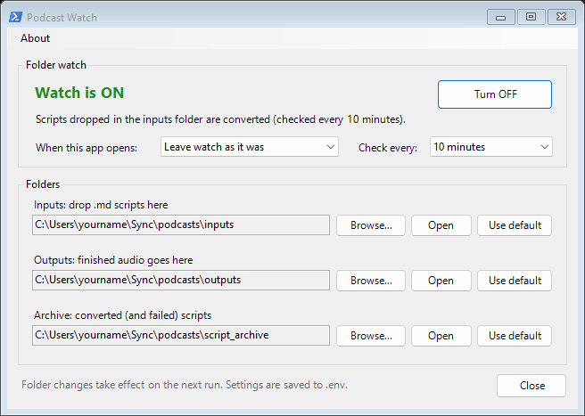

# podcast_generator

Converts markdown podcast scripts into spoken-word audio files, using
[`voxport`](https://github.com/brienalkire/voxport)'s `KokoroDirectTTS` for
local, offline-capable text-to-speech. No API key, no per-use cost, and
your scripts never leave your machine.

- **`podcast-generator`**: converts scripts from the command line.
- **Drop-folder mode**: a Windows scheduled task converts whatever lands in
  an inputs folder (cloud-synced, if you like), controlled from the small
  **Podcast Watch** app (`podcast-watch`).
- **`podcast-generator-mcp`**: an MCP server, so Claude Desktop or another
  MCP client can write, queue and convert podcasts for you.

This README is a quick start. See
[MANUAL.md](https://github.com/brienalkire/podcast_generator/blob/main/MANUAL.md)
for the full guide: script-writing conventions, complete CLI reference, the
voice catalog, and troubleshooting.

## Installation

Requires Python 3.10+. The command line works anywhere Kokoro does; the
Podcast Watch app and scheduled drop-folder mode are Windows-only.

```
pip install podcast-generator             # command line and Podcast Watch
pip install "podcast-generator[mcp]"      # plus the MCP server
```

The PyPI name is `podcast-generator`, with a hyphen; the Python package
is `podcast_generator`, with an underscore. A virtual environment is
recommended. This pulls in Kokoro and torch (about 2 GB) through
`voxport[kokoro]`. Torch's default build runs on the CPU, so no GPU or
special torch install is needed. Check the install:

```
podcast-generator --version
```

Not installed for you:

- **ffmpeg**: needed for MP3 output unless your `soundfile`/libsndfile
  build has native MP3 support. Put it on `PATH`. WAV output needs neither.
- **Kokoro model weights and spaCy's `en_core_web_sm`**: downloaded
  automatically on the first run.

Behind a corporate firewall or proxy, or on a work computer that blocks
new programs? The manual covers
[firewalls and proxies](https://github.com/brienalkire/podcast_generator/blob/main/MANUAL.md#behind-a-corporate-firewall-or-proxy)
(certificate errors, blocked downloads),
[offline use](https://github.com/brienalkire/podcast_generator/blob/main/MANUAL.md#offline-use),
and
[managed computers](https://github.com/brienalkire/podcast_generator/blob/main/MANUAL.md#managed-or-locked-down-computers)
(installing into an existing environment, and `python -m` instead of the
`.exe` commands).

### From a source checkout

```
git clone https://github.com/brienalkire/podcast_generator.git
cd podcast_generator
python -m venv .venv
.venv\Scripts\activate          # Windows (bash: source .venv/bin/activate)
pip install -e ".[mcp]" pytest
```

Working on voxport at the same time? Clone it next to this repo and run
`pip install -e "../voxport[kokoro]"` afterwards.

## Where things live

Settings and the default folders live in one **home folder**:

| Install | Home folder |
|---|---|
| `pip install` | `podcast_generator` in your Documents folder |
| Source checkout | the repo folder |
| Either | `PODCAST_GENERATOR_HOME`, if you set that environment variable |

It holds `.env` (settings), `inputs/` (scripts waiting to be converted),
`outputs/` (finished audio), `script_archive/` (converted scripts, and
`failed/` for ones that didn't convert), and `generator.log`.

The three folders can point anywhere. Use the Podcast Watch app, or set
`PODCAST_INPUTS_DIR`, `PODCAST_OUTPUTS_DIR` and `PODCAST_ARCHIVE_DIR` in
`.env` (see
[`.env.example`](https://github.com/brienalkire/podcast_generator/blob/main/.env.example)).
Pointing them at a cloud-synced folder (Sync.com, Dropbox, OneDrive) lets
you drop a script in from any device and get the audio back the same way.

## Usage

### Writing a script

A script is a markdown file. Plain paragraphs are spoken. Headers,
`**Key:** value` metadata lines, horizontal rules, and italic-only lines
are stripped, so you can label sections and add notes without them being
read aloud:

```markdown
# My Episode Title

**Voice:** af_heart

## OPENING

Welcome back to the show. Today we're talking about...

## CLOSING

That's all for this episode. Thanks for listening.

---

*Source: some-article.com, September 2026.*
```

Only the two paragraphs are spoken. An italic-only line after the prose
starts ends the script, and everything after it is dropped. Keep those
lines for trailing notes. See the
[manual](https://github.com/brienalkire/podcast_generator/blob/main/MANUAL.md#writing-a-script)
for the full rules.

**Conversations with two or more speakers** work too. Add a line like
`**Voices:** Maya=af_heart, Theo=bm_george` and start each spoken line with
the speaker's name (`Maya: Welcome back.`). Each speaker is read in their
own voice, with a short pause between turns. See
[Two or more speakers](https://github.com/brienalkire/podcast_generator/blob/main/MANUAL.md#two-or-more-speakers-dialogue).

### Running it

```
podcast-generator                                  # batch: every script in inputs/
podcast-generator --voice af_heart --speed 1.1     # batch, overriding voice and speed
podcast-generator my-script.md --format wav --output episode01.wav   # one file
```

**Batch mode** (no file argument) converts every `.md` script in the inputs
folder and writes `<script-name>.mp3` to the outputs folder. The first run
creates the inputs folder if it doesn't exist. Each script that converts
successfully moves into the archive folder, so re-running doesn't
reprocess it. A script that fails moves to `<archive folder>/failed/` with
a `.error.txt` note, so it isn't retried forever.

**Single-file mode** converts just the named file. `--output` only applies
here.

| Option | Meaning |
|---|---|
| `--voice VOICE` | Kokoro voice for the whole run. Overrides a script's `**Voice:**` line (in a dialogue, only the narrator's). Default `af_heart`. |
| `--speed FLOAT` | Speaking rate (default `1.0`; `0.9` slower, `1.1` faster). |
| `--format {mp3,wav}` | Output format (default `mp3`). |
| `--output PATH` | Output file (single-file mode only). |
| `--lang CODE` | Accent override; normally inferred from the voice name. |
| `--version` | Print the version and exit. |

Voice precedence: `--voice`, then the script's `**Voice:**` line, then
`af_heart`.

## Drop-folder mode and the Podcast Watch app (Windows)

Running `podcast-generator` with no arguments on a schedule *is* watch
mode: each run converts whatever is new in the inputs folder and archives
it. A run with nothing to do exits almost immediately, and only one
conversion runs at a time.

The **Podcast Watch** app sets this up and controls it:

```
podcast-watch               # open the app
podcast-watch --shortcut    # add a "Podcast Watch" shortcut to your desktop
```

- **Set up watch** registers a Windows scheduled task,
  `PodcastGeneratorWatch`, for your user (no admin rights). It runs the
  converter with `pythonw.exe`, so no window flashes up; output goes to
  `generator.log` in the home folder.
- **Turn ON / Turn OFF** enables or disables it; **Check every** sets the
  interval (5 to 60 minutes).
- **When this app opens** can always turn the watch on or off when you open
  the window.
- **Folders** picks the inputs, outputs and archive folders.



To remove the task: `Unregister-ScheduledTask -TaskName PodcastGeneratorWatch`
in PowerShell. On macOS or Linux, schedule `podcast-generator` with cron or
a similar tool instead.

## Using it from Claude Desktop (MCP)

`podcast-generator-mcp` is an [MCP](https://modelcontextprotocol.io) server,
so an AI app such as Claude Desktop can make podcasts directly: write a
script, queue it, convert it, and check on it, all from the chat. It runs
locally and uses the same folders and `.env` as everything else.

1. Install it somewhere that stays put. A [uv](https://docs.astral.sh/uv/)
   or [pipx](https://pipx.pypa.io/) tool install works well:

   ```
   uv tool install "podcast-generator[mcp]"
   ```

   (`pipx install "podcast-generator[mcp]"` is the same. A virtual
   environment works too, as long as you don't delete it.)
2. Print the Claude Desktop config for that install:

   ```
   podcast-generator-mcp --config
   ```

   It gives the command's full path, which Claude Desktop needs because it
   doesn't see your shell's `PATH`.
3. In Claude Desktop, open Settings → Developer → Edit Config, merge that
   `"podcast-generator"` entry into `mcpServers`, and fully quit and restart
   Claude Desktop (on Windows, quit from the system tray). It then appears in
   the chat box's connectors menu.

See the
[manual](https://github.com/brienalkire/podcast_generator/blob/main/MANUAL.md#using-it-from-claude-desktop-mcp)
for checking it's installed, example requests, the tools, and upgrading
(quit Claude Desktop first).

## License

MIT. See [LICENSE](https://github.com/brienalkire/podcast_generator/blob/main/LICENSE).
